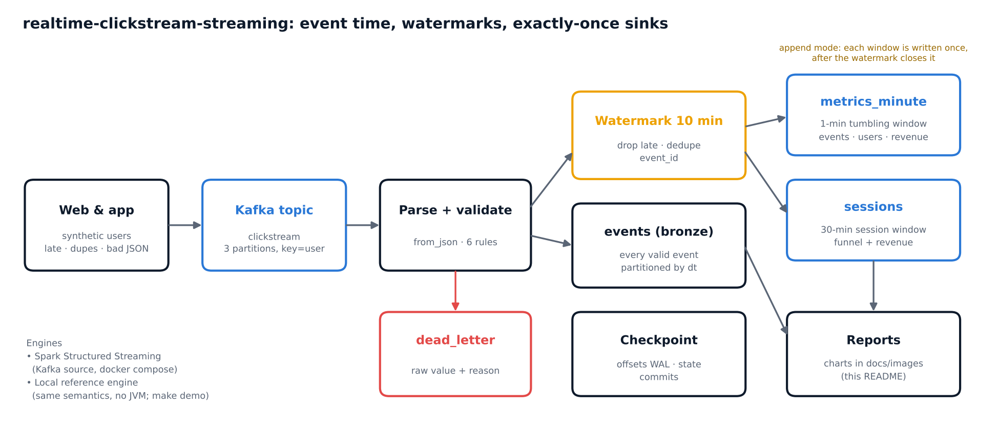
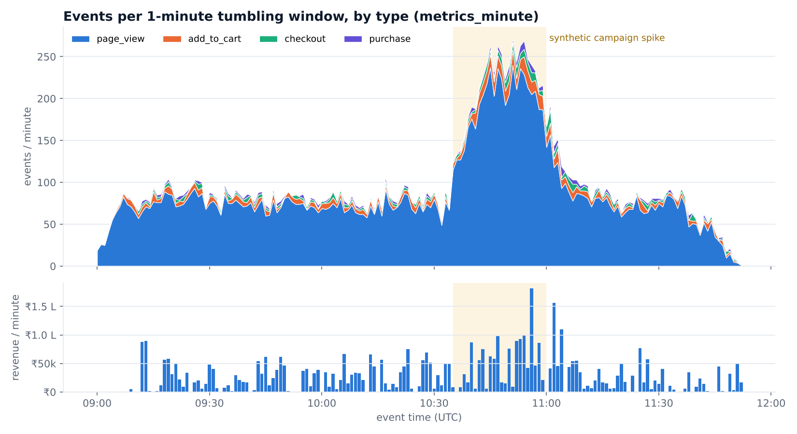
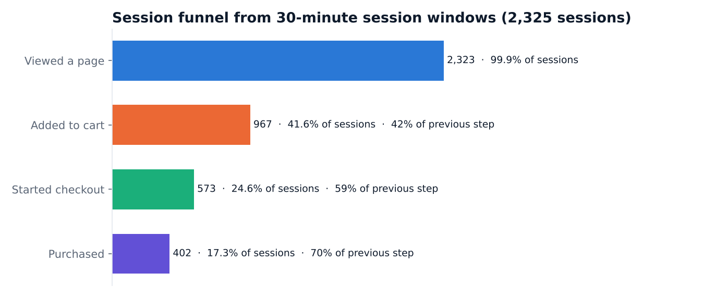
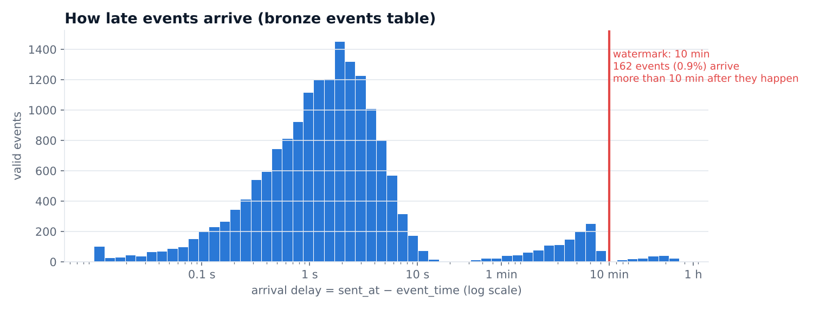
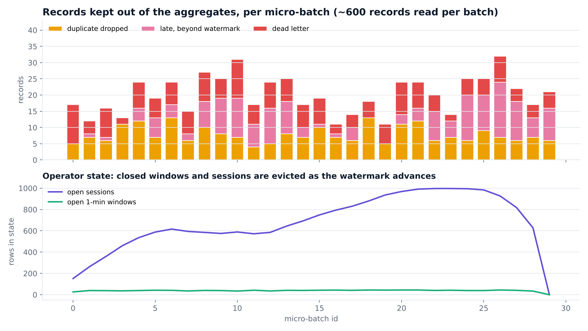
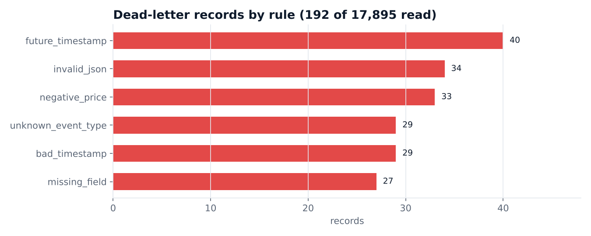

# Real-time Clickstream Streaming

[](https://github.com/vishavjit-singh/realtime-clickstream-streaming/actions/workflows/ci.yml)
[](https://github.com/vishavjit-singh/realtime-clickstream-streaming/actions/workflows/spark.yml)


A streaming pipeline for website and app clickstream. Events flow from **Kafka** into **Spark Structured Streaming**. They are validated, deduplicated and aggregated in **event time** behind a **10-minute watermark** into 1-minute traffic metrics and 30-minute **session windows**. The output is written once, as partitioned **Parquet**, through checkpointed, exactly-once file sinks.

The same semantics are implemented a second time in a small pure-Python **reference engine**. That engine is what `make demo` runs, so the project works end to end without a JVM or a broker. A parity test in CI checks that Spark and the reference engine produce identical windows and sessions.



## Why this project

Clickstream is the textbook streaming workload, and it breaks every assumption a batch job can make:

| Problem in a real event stream | How the pipeline handles it |
|---|---|
| Mobile clients buffer events offline and send them minutes later | Aggregations run on **event time**, not arrival time. A **10-minute watermark** waits for stragglers |
| Some events arrive hours late and would keep state open forever | Events behind the watermark are **kept out of aggregates** but still land in the bronze `events` table, ready for batch backfill |
| Producers retry after a lost ack, so the same event arrives twice | **`event_id` deduplication** within the watermark (`dropDuplicatesWithinWatermark`) |
| A device with its clock hours ahead would drag the watermark forward and get everyone else's events dropped as "late" | **`future_timestamp` rule**: an `event_time` more than 5 min ahead of `sent_at` goes to the dead-letter table and never moves the watermark |
| Broken JSON, missing fields, an old SDK sending `pageview` | Six validation rules. Rejected rows go to **`dead_letter`** with the raw payload and the reason |
| Sessions have no fixed length | **Session windows** with a 30-minute inactivity gap. A late event that falls between two sessions merges them |
| A crash mid-batch must not double-count or lose data | Offsets are written **before** a batch runs and a commit **after** its sinks. Recovery replays the exact offset range and overwrites the same files |
| State must not grow without bound | Append output mode: windows and sessions are written **once** when the watermark closes them, then evicted from state |

## Results from the demo run

`make demo` generates three hours of **synthetic** clickstream (1,500 users, a marketing-campaign spike, and the faults listed above). It streams the data through the reference engine in 600-record micro-batches. It stops after 12 batches, restarts from the checkpoint, finishes, and renders these charts from the tables it wrote.

**Traffic per 1-minute tumbling window** (`metrics_minute`). The shaded band is the synthetic campaign:



**Session funnel**, computed from the session windows rather than from a session id sent by the client:



**Why the watermark is 10 minutes.** Most events arrive within seconds. Buffered mobile events form a second hump below 10 minutes, and a small tail arrives later than that:



**Per micro-batch:** records kept out of the aggregates, and operator state growing with traffic and shrinking as the watermark closes windows and sessions:





| Metric (demo run, synthetic data) | Value |
|---|---|
| Records read from the log | 17,895 in 30 micro-batches |
| Dead-lettered | 192 (6 rules) |
| Duplicate deliveries dropped | 234 |
| Late events kept out of aggregates (still in bronze) | 177 |
| Events aggregated | 17,286 |
| 1-minute windows / sessions written | 654 / 2,325 |
| Session conversion to purchase | 17.3% (402 sessions) |
| Consistency checks | Σ window events = Σ session events = events aggregated ✔ |
| Stop after 12 batches, restart, finish | Identical output to an uninterrupted run (tested) |

> All data is synthetic, generated by `clickstream/generator.py` with a fixed seed so every number above is reproducible. Rates of lateness, duplicates and malformed records are set in [`config/streaming.yaml`](config/streaming.yaml).

## Output tables

| Table | Grain | Written by | Partitioned by |
|---|---|---|---|
| `events` | one row per valid event, as delivered (bronze) | stateless query | event date |
| `dead_letter` | one row per rejected record: raw value, reason, Kafka partition and offset | stateless query | ingest date |
| `metrics_minute` | event type × 1-minute window: `events`, `users`, `revenue` | watermark + dedupe + tumbling window | window date |
| `sessions` | user × session window: event counts per funnel step, revenue, `converted` | watermark + dedupe + session window | session date |

## Two engines, one set of semantics

| | Spark Structured Streaming ([`spark_job.py`](src/clickstream/spark_job.py)) | Reference engine ([`operators.py`](src/clickstream/operators.py), [`engine.py`](src/clickstream/engine.py)) |
|---|---|---|
| Source | Kafka topic (`maxOffsetsPerTrigger`) or a directory of files | Local partitioned log with Kafka-style offsets |
| Watermark | `withWatermark("event_time", "600 seconds")` | `max(event_time) − 10 min`, applied from the next batch |
| Dedupe | `dropDuplicatesWithinWatermark(["event_id"])` | `event_id` state, evicted behind the watermark |
| Windows | `window(…, "1 minute")`, `session_window(…, "30 minutes")` | Same boundaries; session merge on overlap |
| Exactly-once | Checkpoint + file-sink metadata log | Offset WAL → sinks → state → commit |
| Runs where | docker compose, the Spark CI workflow, any cluster | Anywhere with Python: `make demo`, unit tests |

[`tests/spark/test_spark_parity.py`](tests/spark/test_spark_parity.py) runs both engines on the same stream and asserts identical minute metrics, sessions, bronze rows and dead letters. One exception is the `users` column: Spark uses HyperLogLog++, so a 5% tolerance applies there. The parity stream contains no events behind the watermark, because Spark documents that it *may or may not* drop those.

## Quickstart

```bash
git clone https://github.com/vishavjit-singh/realtime-clickstream-streaming.git
cd realtime-clickstream-streaming
python -m venv .venv && source .venv/bin/activate
make install
make demo      # generate → stream → restart → finish → charts → summary
make test      # 45 tests, plus 3 Spark parity tests when pyspark is installed
```

### Kafka + Spark with Docker

```bash
docker compose up --build    # Kafka (KRaft), topic creation, producer, Spark job
make report-spark            # charts from data/spark_lake into data/spark_report
docker compose down -v
```

The producer replays the synthetic stream at 120× real time, keyed by `user_id` so each user's events stay ordered within a partition. The Spark job runs a 10-second processing-time trigger and writes Parquet to `./data/spark_lake`.

### Spark without Kafka

```bash
pip install -r requirements-stream.txt   # pyspark 3.5 + Java 17
make spark-demo                          # file source, one file per micro-batch
```

### CLI

| Command | What it does |
|---|---|
| `generate` | Writes the synthetic stream into the local log, closed with watermark-advancing heartbeats |
| `run [--max-batches N]` | Runs the reference engine over everything available, resuming from the checkpoint |
| `summary` | Prints headline numbers and consistency checks as JSON |
| `report [--lake --checkpoint --out]` | Renders the charts, from either engine's lake |
| `export-files` | Writes the stream as numbered files for Spark's file source |
| `produce --bootstrap host:port` | Replays the stream into Kafka (idempotent producer, `acks=all`) |
| `spark --source kafka\|files` | Starts the four Spark streaming queries |

All commands run as `PYTHONPATH=src python -m clickstream <command>`.

## Project structure

```
├── config/streaming.yaml          # watermark, windows, trigger size, generator fault rates
├── src/clickstream/
│   ├── schema.py                  # event contract + 6 validation rules
│   ├── generator.py               # synthetic users, sessions, lateness, dupes, bad records
│   ├── log.py                     # partitioned append-only log (Kafka stand-in)
│   ├── operators.py               # watermark, dedupe, tumbling + session windows
│   ├── engine.py                  # micro-batch loop, offset WAL, checkpoint, recovery
│   ├── sinks.py                   # partitioned Parquet/CSV per batch, idempotent overwrite
│   ├── spark_job.py               # Spark Structured Streaming job (Kafka or files)
│   ├── kafka_io.py                # paced replay into Kafka
│   ├── report.py                  # charts for this README
│   └── cli.py
├── tests/                         # unit, end-to-end, recovery, Spark parity
├── docker-compose.yml             # Kafka (KRaft) + producer + Spark
├── Dockerfile                     # Python 3.11 + Java 17 + pyspark
├── Makefile
└── .github/workflows/
    ├── ci.yml                     # lint, tests, demo, image smoke test
    └── spark.yml                  # Spark parity tests, Spark demo, compose run
```

## Testing

- **Validation**: every rule rejects exactly what it should, in a fixed order, and timestamps normalise to UTC.
- **Operators**: windows close only once the watermark passes them; late rows are judged against the *previous* batch's watermark; the watermark never moves backwards and dead letters never move it; duplicates are dropped across batches; a late event bridges two sessions into one.
- **Engine**: every record is accounted for; batches respect the record budget; a re-run with no new data writes nothing; new data is picked up incrementally.
- **Exactly-once recovery**: a crash injected after the sinks are written but before the commit is replayed on restart, and the final tables are identical to a clean run.
- **Batch-size invariance**: without very late data, 90-record and 700-record micro-batches produce identical windows and sessions.
- **Kafka replay** with a fake producer: arrival order, keys, pacing and heartbeat rounds.
- **Spark parity** (`spark.yml`): Spark and the reference engine agree on every output table.

## Limitations and roadmap

- The data is synthetic. The generator models common failure modes, but real traffic would have different shapes.
- `users` per window counts distinct users exactly in the reference engine and approximately in Spark.
- The reference engine runs on a single process. It exists to make the semantics testable without a cluster, not to replace Spark.
- [ ] Write the Spark sinks as Delta Lake tables and `MERGE` late events from bronze into the aggregates in a nightly batch job
- [ ] Schema Registry with Avro or Protobuf instead of JSON
- [ ] Export `StreamingQueryProgress` to Prometheus and alert on watermark lag
- [ ] Stream-static join to enrich events with a product catalogue

## Author

**Vishavjit Singh Saini**, Data Engineer
[Portfolio](https://vishavjit-saini.pages.dev/) · [LinkedIn](https://www.linkedin.com/in/vishavjit-singh-7011211ab/) · [GitHub](https://github.com/vishavjit-singh)

## License

[MIT](LICENSE)
